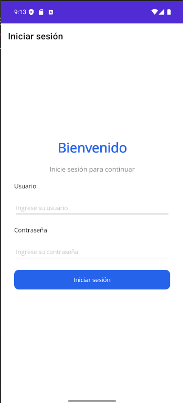
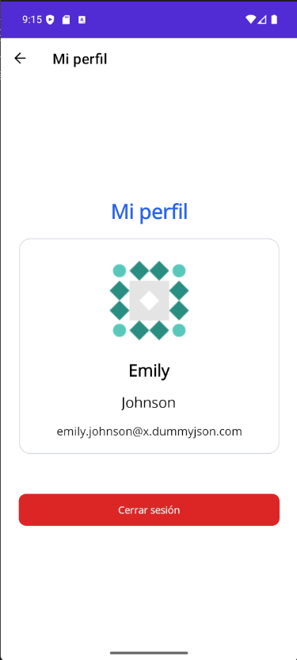
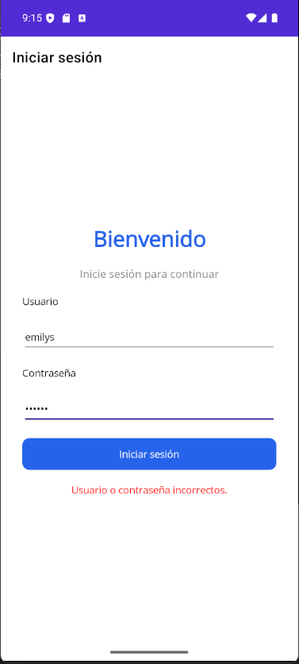


# Tarea 8 - Inicio de sesión con token y SecureStorage

## Descripción
Aplicación desarrollada con .NET MAUI y C# que implementa autenticación mediante una API REST, almacenamiento seguro de tokens y consulta de información protegida.

## Tecnologías utilizadas
- Visual Studio 2026
- .NET 10 MAUI
- C#
- HttpClient
- System.Text.Json
- SecureStorage
- Preferences
- API REST DummyJSON

## API utilizada
https://dummyjson.com/auth/login
https://dummyjson.com/auth/me

## Funcionalidades
- Inicio de sesión mediante POST.
- Validación de campos obligatorios.
- Lectura del accessToken de la respuesta JSON.
- Almacenamiento del token mediante SecureStorage.
- Almacenamiento del nombre de usuario mediante Preferences.
- Consulta del perfil mediante GET con encabezado Authorization: Bearer.
- Visualización del nombre, correo electrónico y fotografía.
- Inicio de sesión automático si existe un token guardado.
- Cierre de sesión y eliminación del token.
- Manejo de credenciales incorrectas y errores de conexión.
- Indicadores de carga mediante ActivityIndicator.

## Credenciales de prueba
- Usuario: emilys
- Contraseña: emilyspass

## Capturas de pantalla

### Inicio de sesión

### Perfil del usuario

### Mensaje de error

## Seguridad
La contraseña no se almacena. El token de acceso se guarda mediante SecureStorage y se elimina al cerrar sesión.

## Autor
Grupo #3 - Programación de Dispositivos Móviles II
